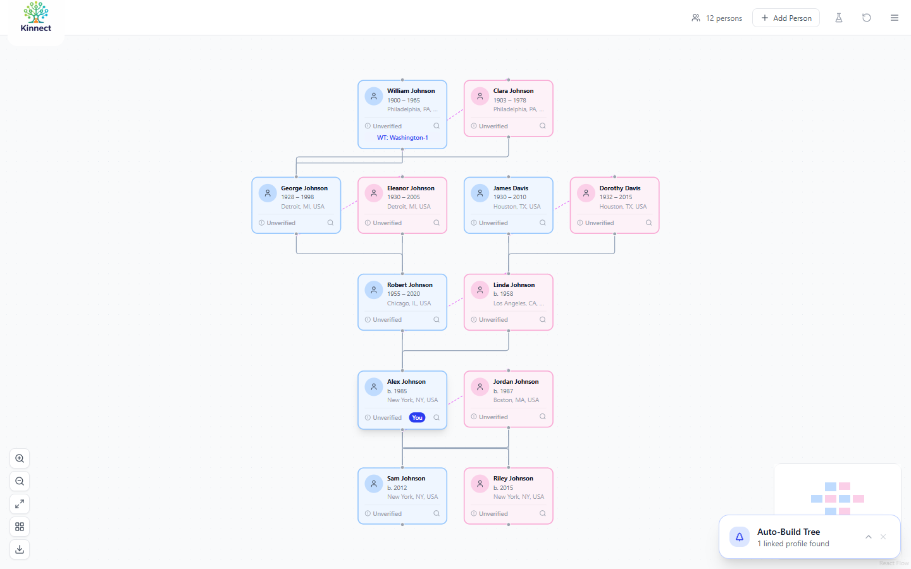

# Kinnect

**Live demo: [kinnect-blue.vercel.app](https://kinnect-blue.vercel.app)** (click *Try Demo*, no sign-up)

A family tree that grows itself. Enter what you know about yourself and your
immediate family, and Kinnect searches public records across 14 sources to
suggest ancestors and extend the tree, tracking every fact back to its source
following the **Genealogical Proof Standard (GPS)** that professional
genealogists use.



**Highlights**

- **Searches many archives at once.** One query fans out to FamilySearch,
  WikiTree, Wikidata, Wikipedia, the Library of Congress, Chronicling America,
  NARA, DPLA, Europeana, Trove, the Internet Archive, Open Library, SNAC and
  news sources. Results stream back with **Server-Sent Events**, so matches
  appear as each source responds instead of waiting for the slowest one.
- **Auto-building tree.** Extracts relatives mentioned in found records and
  proposes them as new people, extending the tree generation by generation.
- **Evidence over guesses.** Each person carries citations and a GPS status
  (exhaustive search, complete citations, source analysis, conflict
  resolution, written conclusion). Auto-added people stay "unverified" until
  their evidence meets the standard.
- **Interactive tree.** Drag, zoom, auto-organize, edit any fact, per-person
  comment threads, and PDF export. The tree is saved in the browser and
  survives restarts. Responsive layout with bottom-sheet panels on mobile.

**Stack:** Next.js 15 (App Router), React 18, TypeScript, React Flow, zustand,
Tailwind CSS, Radix UI, zod, jsPDF

## Develop

```bash
npm install
cp .env.example .env.local   # optional: FamilySearch API credentials
npm run dev                  # http://localhost:3000
npm run type-check
```

Most sources are open APIs and need no keys. FamilySearch search requires
registering an app with FamilySearch and setting `FAMILYSEARCH_CLIENT_ID` /
`FAMILYSEARCH_CLIENT_SECRET`.

## Project layout

```
src/
  app/api/records/search    streaming multi-source record search (SSE)
  app/api/ancestors/suggest streaming ancestor suggestions (SSE)
  app/api/tree/extend       auto-extend the tree from found records
  lib/                      one client per archive + gps.ts + treeBuilder.ts
  components/FamilyTree     React Flow tree, layout, auto-builder
  components/PersonDetail   facts editor, citations, comments
  store/                    zustand store (persisted to localStorage)
```
